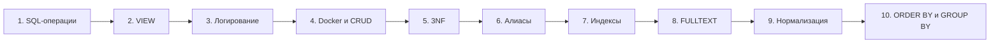

<div align="center">

# 🗄️ Лабораторные работы по базам данных

**Дисциплина: Основы проектирования баз данных**


Сборник лабораторных работ по MySQL: от базовых операций реляционной алгебры до нормализации, индексов и полнотекстового поиска. Каждая работа лежит в отдельном репозитории, а здесь собраны все ссылки.

**Студент:** [ChrisRedfield48](https://github.com/ChrisRedfield48) · **Период:** ноябрь 2026

</div>

---

## Навигация

- [Список работ](#список-работ)
- [Маршрут обучения](#маршрут-обучения)
- [Среда выполнения](#среда-выполнения)
- [Быстрый старт](#быстрый-старт)

---

## Список работ

| № | Тема | Что осваивается | Репозиторий |
|:-:|------|-----------------|-------------|
| 1 | **Основные SQL-операции** | Выборка, проекция, `UNION`, `EXCEPT`, `INTERSECT`, `JOIN`, дамп и восстановление БД | [products-mysql-sql-lab](https://github.com/ChrisRedfield48/products-mysql-sql-lab) |
| 2 | **Представления** | `VIEW` в MySQL | [mysql-views-lab](https://github.com/ChrisRedfield48/mysql-views-lab) |
| 3 | **Интерактивная работа: логирование** | Запись действий в таблицу-лог | [mysql-interactive-lab](https://github.com/ChrisRedfield48/mysql-interactive-lab) |
| 4 | **Интерактивная работа: Docker и CRUD** | Работа с MySQL в контейнере, операции создания, чтения, изменения и удаления | [mysql-docker-basics](https://github.com/ChrisRedfield48/mysql-docker-basics) |
| 5 | **Нормализация данных** | Приведение к третьей нормальной форме (3NF) | [mysql-normalization-lab](https://github.com/ChrisRedfield48/mysql-normalization-lab) |
| 6 | **Алиасы** | Псевдонимы таблиц и столбцов в SQL | [mysql-aliases-lab](https://github.com/ChrisRedfield48/mysql-aliases-lab) |
| 7 | **Индексы** | Индексы в MySQL | [mysql-indexes-lab](https://github.com/ChrisRedfield48/mysql-indexes-lab) |
| 8 | **Полнотекстовый поиск** | Индексы и поиск `FULLTEXT` | [mysql-fulltext-lab](https://github.com/ChrisRedfield48/mysql-fulltext-lab) |
| 9 | **Нормализация: все формы** | Нормальные формы целиком | [mysql-all-normalization-lab](https://github.com/ChrisRedfield48/mysql-all-normalization-lab) |
| 10 | **Сортировка и группировка** | `ORDER BY` и `GROUP BY` | [mysql-orderby-groupby-lab](https://github.com/ChrisRedfield48/mysql-orderby-groupby-lab) |

---

## Маршрут обучения



---

## Среда выполнения

| Компонент | Версия / значение |
|-----------|-------------------|
| 🖥 ОС | macOS (Apple Silicon) |
| ⌨️ Терминал | zsh |
| 🐳 Docker | Docker Desktop |
| 🗃 Образ MySQL | `mysql:latest` → **MySQL Community Server 26.10.0** |
| 🔤 Кодировка | `utf8mb4` / `utf8mb4_unicode_ci` |
| 🔌 Клиент | `mysql` CLI внутри контейнера |

---

## Быстрый старт

Все работы выполняются в Docker, поэтому окружение поднимается одинаково для любой лабораторной.

**1. Конфиг для корректной работы с кириллицей** (`my.cnf`):

```ini
[mysqld]
character-set-server = utf8mb4
collation-server = utf8mb4_unicode_ci

[client]
default-character-set = utf8mb4

[mysql]
default-character-set = utf8mb4
```

**2. Запуск контейнера:**

```bash
docker run --name products-mysql \
  -e MYSQL_ROOT_PASSWORD=123 \
  -e LANG=C.UTF-8 \
  -v mysql_data:/var/lib/mysql \
  -v "$(pwd)/my.cnf:/etc/mysql/conf.d/my.cnf" \
  -d mysql:latest
```

**3. Подключение к MySQL:**

```bash
docker exec -it products-mysql mysql -uroot -p123
```

> [!NOTE]
> Пароль `123` используется только в учебных целях. В реальных проектах так делать не стоит.

> [!TIP]
> Дамп базы и восстановление из него описаны в [лабораторной №1](https://github.com/ChrisRedfield48/products-mysql-sql-lab).

---

<div align="center">

⬆️ [Наверх](#️-лабораторные-работы-по-базам-данных)

_© 2026 ChrisRedfield48_

</div>